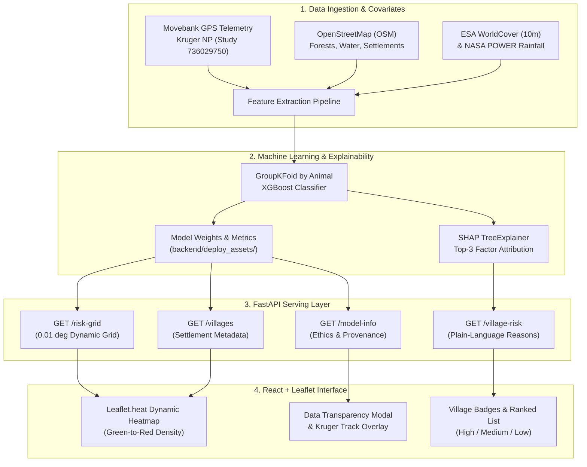

# GajRaksha

**Transfer-Learning System for Predicting Elephant Presence Risk Near Villages in South Bengal**

---

## Problem Statement

Human-elephant conflict (HEC) is a critical challenge across the fragmented agricultural and forest interface of South Bengal, covering the districts of Jhargram, Paschim Medinipur, Bankura, and Purulia in West Bengal, India. Rapid land-use fragmentation and seasonal crop availability bring free-ranging elephant herds into frequent proximity with rural communities. Because public telemetry from Indian elephants is currently unavailable for open research, **GajRaksha** uses an ecological transfer learning framework: an XGBoost risk model is trained on 34,483 hourly GPS collar tracking records from Kruger National Park, South Africa (Movebank Study ID: 736029750), utilizing shared ecological covariates—such as distance to forest edges, distance to water sources, agricultural cropland density, diurnal cycles, and cumulative rainfall. The model is then transferred to predict and visualize **elephant presence near villages as a proxy for conflict risk**, enabling preemptive village-level spatial awareness and timely patrol dispatch.

---

## Screenshots

| Full-Screen Risk Heatmap & Settlement Rings | Nocturnal (02:00) vs. Diurnal (14:00) Shift |
|:---:|:---:|
|  |  |

| Village Detail Card with SHAP Factors | Data Transparency & Movebank Provenance Modal |
|:---:|:---:|
|  |  |

---

## Architecture Diagram



---

## Tech Stack

- **Backend**: Python 3.11+, [FastAPI](https://fastapi.tiangolo.com/), [Uvicorn](https://www.uvicorn.org/), [XGBoost](https://xgboost.readthedocs.io/), [SHAP](https://shap.readthedocs.io/), [Scikit-learn](https://scikit-learn.org/), [Pandas](https://pandas.pydata.org/), [NumPy](https://numpy.org/), [SciPy](https://scipy.org/).
- **Frontend**: [React 18](https://react.dev/), [Vite 5](https://vitejs.dev/), [Leaflet 1.9.4](https://leafletjs.com/), [leaflet.heat 0.2.0](https://github.com/Leaflet/Leaflet.heat), Plain CSS.
- **Geospatial & Environmental**: OpenStreetMap Overpass & Nominatim APIs, ESA WorldCover 10m Land Cover, NASA POWER Agroclimatology.
- **Deployment**: Docker, Render Blueprint (`render.yaml`).

---

## Setup & Run Commands

### 1. Backend Setup

```bash
# Clone repository
git clone https://github.com/your-username/gajraksha.git
cd gajraksha

# Create and activate Python virtual environment
python -m venv backend/venv

# Activate (Windows):
backend\venv\Scripts\activate
# Activate (Linux / macOS):
source backend/venv/bin/activate

# Install dependencies
pip install -r requirements.txt

# Start FastAPI server
uvicorn backend.main:app --host 127.0.0.1 --port 8000 --reload
```

The interactive API Swagger docs will be accessible at: `http://127.0.0.1:8000/docs`.

### 2. Frontend Setup

```bash
# Open frontend directory
cd frontend

# Install dependencies
npm install

# Start Vite development server
npm run dev
```

Open `http://localhost:5173` in your browser to interact with the live map.

---

## How to Deploy

### Option A: Render (Blueprint)
The repository includes a ready-to-use [`render.yaml`](file:///d:/GAJRAKSHA/render.yaml) blueprint:
1. Connect this repository to your [Render Dashboard](https://dashboard.render.com).
2. Select **New** > **Blueprint** and link the repo.
3. Render automatically provisions:
   - A Python Web Service running the FastAPI backend from `backend/deploy_assets/`.
   - A Static Web Site building and hosting the Vite React frontend.

### Option B: Docker
Build and run the containerized application with the included [`Dockerfile`](file:///d:/GAJRAKSHA/Dockerfile):

```bash
# Build Docker image
docker build -t gajraksha:latest .

# Run container on port 8000
docker run -d -p 8000:8000 --name gajraksha-app gajraksha:latest
```

Visit `http://localhost:8000` to access the service.

---

## Limitations

1. **Training Data Origin**: The predictive model was trained on African elephant (*Loxodonta africana*) GPS collar tracks from the Kruger National Park landscape in South Africa (Movebank Study `736029750`).
2. **Geographic Transfer**: The model is transferred to the South Bengal human-wildlife interface (Jhargram, Paschim Medinipur, Bankura, and Purulia) by translating universal habitat features (distance to forest cover, distance to water sources, agricultural cropland density, hour-of-day diurnal rhythms, and cumulative rainfall).
3. **External Sanity Check**: Predictions have been sanity-checked against published historical conflict hotspots from the Wildlife Institute of India (WII) West Bengal Human-Elephant Conflict Report (2000–2025).
4. **Validation Status**: The model has **not yet been trained or validated on Indian elephant (*Elephas maximus*) collar telemetry data**, as open collar datasets for this region are not currently available.
5. **Proxy Interpretation**: The system **predicts elephant presence near villages as a proxy for conflict risk**, not confirmed physical incidents, crop-raiding events, or direct human attacks. Outputs should be treated as spatial decision support to guide patrol allocation and awareness rather than guarantees of presence or absence.
